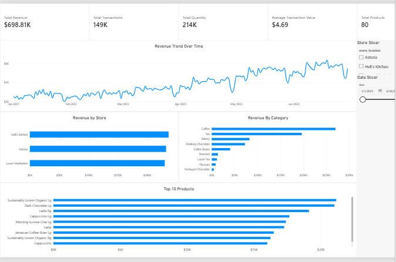
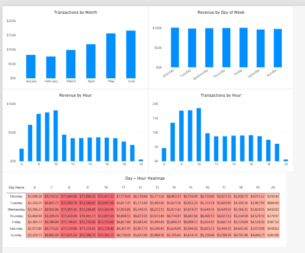
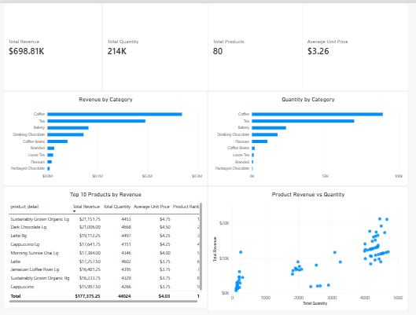
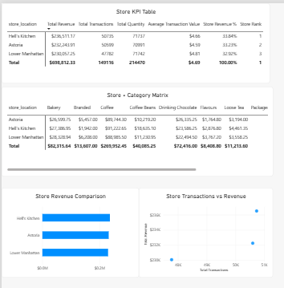

# Coffee Shop Sales Analysis | Power BI

## Project Overview

This project analyzes coffee shop sales from January 1 to June 30, 2023, using Microsoft Power BI. It explores store performance, product revenue, transaction activity, and sales patterns by hour and day of the week.

The project demonstrates an end-to-end data analytics workflow, including data validation, Power Query, star-schema modeling, DAX measures, interactive dashboards, and business insight generation.

## Business Objectives

- Evaluate overall sales and transaction performance.
- Compare revenue and average transaction value across stores.
- Identify leading product categories and products by revenue.
- Analyze peak sales hours and days of the week.
- Identify patterns that could inform inventory and operational planning.

## Dataset Overview

The dataset contains 149,116 records and 11 columns covering six months of coffee shop sales.

| Attribute | Value |
|---|---:|
| Records | 149,116 |
| Columns | 11 |
| Unique transaction IDs | 149,116 |
| Products | 80 |
| Stores | 3 |
| Product categories | 9 |
| Product types | 29 |
| Date range | Jan 1 – Jun 30, 2023 |

The dataset includes transaction dates and times, quantities, unit prices, store locations, product identifiers, categories, and product descriptions.

**Data quality:** Initial validation found no missing values or exact duplicate rows. The source dataset was already clean, so unnecessary data-removal operations were avoided.

## Tools and Technologies

- **Microsoft Power BI:** Interactive dashboards and visual analytics
- **Power Query:** Data inspection, validation, and preparation
- **DAX:** Measures, KPIs, and analytical calculations
- **GitHub:** Project documentation and version control

## Data Modeling

The report uses a star-schema approach to organize sales data and support interactive analysis.

| Table | Purpose |
|---|---|
| `FactSales` | Sales records, quantities, and revenue |
| `DimDate` | Date attributes for time-based analysis |
| `DimProduct` | Product names, types, and categories |
| `DimStore` | Store identifiers and locations |
| `_Measures` | Organized DAX measures |

Dimension tables connect to the sales fact table through one-to-many relationships.

Revenue is calculated as:

```text
Revenue = Transaction Quantity × Unit Price
```

## Key Performance Indicators

The report includes DAX measures for:

- **Sales performance:** Total Revenue, Total Quantity, Total Transactions
- **Average values:** Average Transaction Value and Average Revenue per Unit
- **Product analysis:** Total Products, Product Revenue Contribution, and Product Rank
- **Store analysis:** Store Revenue Contribution and Store Rank

These measures support comparisons across stores, products, categories, and time periods.

## Key Findings

The documented analysis identified the following patterns:

| Finding | Reported result |
|---|---|
| Highest-revenue store | Hell's Kitchen |
| Highest-revenue category | Coffee |
| Coffee revenue contribution | 38.63% |
| Highest-revenue product | Sustainably Grown Organic Lg |
| Peak revenue hour | 10 AM — $88,673.39 |
| Peak transaction hour | 10 AM — 18,545 transactions |
| Highest-revenue weekday | Monday — $101,677.28 |
| Highest-transaction weekday | Friday — 21,701 transactions |

Hell's Kitchen recorded 50,735 transactions and an average transaction value of $4.66. Lower Manhattan recorded fewer transactions overall but had the highest average transaction value among the three stores, at $4.81.

These results illustrate why revenue, transaction volume, quantity sold, and average transaction value should be considered together.

For detailed findings, the top 10 product ranking, store-level weekday patterns, interpretations, and data-validation checks, see **[`documentation/insights.md`](documentation/insights.md)**.

## Dashboard Pages

The Power BI report is organized into four analytical pages:

1. **Executive Overview** — Key performance indicators, revenue trends, and overall sales performance.
2. **Sales & Time Analysis** — Sales activity by date, weekday, and hour.
3. **Product Analysis** — Product rankings, category comparisons, and revenue contribution.
4. **Store Performance** — Store comparisons, transaction activity, and average transaction value.

### Dashboard


**Executive Overview**



**Sales & Time Analysis**



**Product Analysis**



**Store Performance**



## Business Recommendations

Based on the reported patterns, the following areas merit further investigation:

1. **Review peak-hour demand:** Examine staffing and product availability around 10 AM across stores and weekdays.
2. **Investigate coffee category performance:** Identify the products and locations contributing most to coffee's revenue share.
3. **Plan at store level:** Compare each location's weekday and hourly patterns before standardizing operational decisions.
4. **Monitor volume and value together:** Track revenue, transactions, quantity sold, and average transaction value.
5. **Evaluate profitability separately:** Incorporate product costs, waste, labor, and operating expenses before making profit-related decisions.

These are opportunities for further analysis, not proven interventions or guaranteed outcomes.

## Project Limitations

- The dataset covers six months, so it does not support a complete year-over-year comparison.
- Revenue is not profit; product costs and operating expenses are not included.
- The available fields do not support reliable analysis of individual customer retention or lifetime value.
- Descriptive patterns show what happened but do not establish why it happened.

## Repository Structure

```text
coffee-shop-sales-analysis/
├── README.md
├── data/
│   └── coffee_shop_sales.csv
├── powerbi/
│   └── Coffee_Shop_Sales_Analysis.pbix
├── screenshots/
│   ├── executive_overview.png
│   ├── sales_time_analysis.png
│   ├── product_analysis.png
│   └── store_performance.png
└── documentation/
    └── insights.md
```


## Conclusion

This project demonstrates practical skills in data validation, Power Query, data modeling, DAX, and Power BI dashboard development. It uses sales data to examine store performance, product contribution, and time-based patterns, while documenting limitations and areas for further investigation.

## Author

**Zohaib Khalid**


This project is part of my data analytics learning and portfolio development journey.